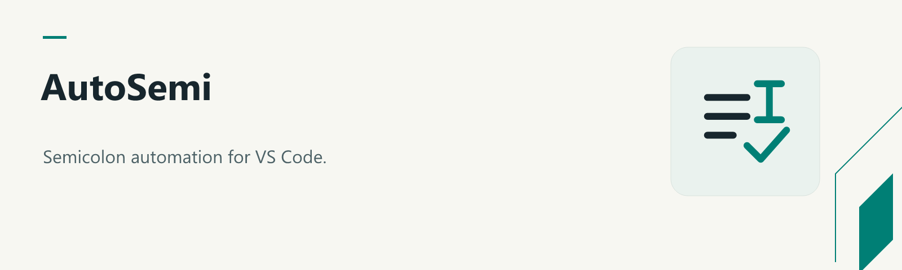
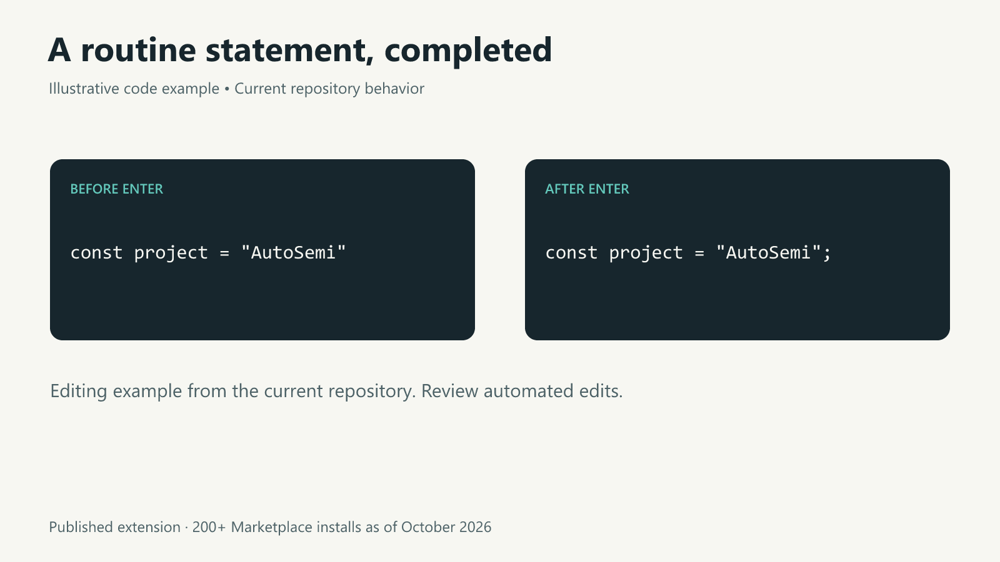

# AutoSemi



**Routine semicolon insertion, built into your coding workflow.**

AutoSemi adds a semicolon to a completed statement when you press Enter. It has **200+ installs** on [Visual Studio Marketplace](https://marketplace.visualstudio.com/items?itemName=Moayad.AutoSemi) as of October 2026.

```javascript
const project = "AutoSemi"  // Press Enter
// becomes:
const project = "AutoSemi";
```



## What it does

- Completes supported statements in JavaScript, TypeScript and Java.
- Keeps URL strings and comment text separate from executable code.
- Inserts before a trailing comment rather than inside it.
- Leaves multiline paste, replacements, undo/redo and multi-cursor changes untouched.
- Cancels pending work when the document or configuration changes.

This is a conservative, heuristic editing tool. It is not an AST parser, linter or formatter. Complex language constructs may be left unchanged; review edits as you would with any editor automation. JSX/TSX are not supported. C# and C++ rules are experimental and disabled by default.

## Install

Search for **AutoSemi** by **Moayad** in VS Code Extensions, or open the [Marketplace listing](https://marketplace.visualstudio.com/items?itemName=Moayad.AutoSemi). VS Code 1.103 or later is required.

## Configure

```json
{
  "autoSemi.enabled": true,
  "autoSemi.languages": ["javascript", "typescript", "java"],
  "autoSemi.skipComments": true,
  "autoSemi.skipStrings": true,
  "autoSemi.debounceDelay": 50,
  "autoSemi.postEditDelay": 50
}
```

Each language also has an `autoSemi.enableFor…` switch. Enabling experimental C# or C++ requires both its switch and its language identifier (`csharp` or `cpp`) in `autoSemi.languages`. Delays are bounded to 0–500 ms. Rapid typing may cancel a pending insertion to avoid changing stale text.

## Development

```sh
npm ci
npm test
npm run package
```

The tests cover lexical decisions and actual VS Code editor behavior. Linux CI runs the editor suite under Xvfb. Packaging produces a local `.vsix`; it does not publish to Marketplace. See [CHANGELOG.md](CHANGELOG.md) for unreleased changes. The Marketplace version remains unchanged until a separate release is published.

## License

[MIT](LICENSE.md) · Built by [Moayad Alshehry](https://github.com/MoayadAlshehry).
